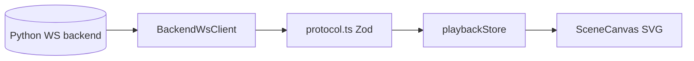

# Architecture

## Layers

```
src/
  app/           AppShell (frame: left pane and the shown section), WorkbenchSection
                 (the workbench views and their state), UI-only Zustand (uiStore, theme)
  components/    Shared UI pieces: Disclosure (+ disclosureStore), PopoverMenu, EmptyState, PageHeader,
                 SectionFrame, LoadingSpinner
  domain/        Simulation protocol, WebSocket client, playback store; cluster/ has the
                 cluster list, the operator API client, the live channel client and stores
  features/      React UI by section: workbench/ (cluster, connection, controls, metrics, monitor,
                 pages, scene), encounter/ (the encounter view of a recorded or live run), domain/,
                 cluster/ (with instances/), capabilities/, campaigns/, history/, results/
  language/      Lezer grammar for .problem files
```

## UI conventions

Sizes are tokens in `index.css` (`:root`): body 16px (`--font-size`), captions 13px at the smallest
(`--font-size-xs`), controls and every clickable thing at least 40px (`--control-height`,
`--hit-target`), spacing on a 4px scale (`--space-1` to `--space-6`). Screens use the tokens rather
than their own sizes. One focus ring (`--focus-ring`) covers all keyboard focus. Scrollbars are overlays
(`app/overlayScrollbars.ts`, installed in `main.tsx`): the native ones are hidden and take no room, and
any element with `overflow: auto` gets a thin thumb while it scrolls or the pointer moves over it.

Colors are tokens too, in `theme.css`: one per role, `:root` is dark mode and `data-theme="light"` on the
root element overrides every one of them. Stylesheets and components hold no colors of their own
(`app/themeTokens.test.ts` fails on a literal color in a stylesheet, on a token one mode lacks and on a light
text token that cannot be read on its surface). A tint keeps its alpha where it is used:
`rgb(var(--danger-rgb) / 0.1)`. `app/theme.ts` keeps the mode per browser (`scenegems:theme`, light by default: `index.html` carries `data-theme="light"`)
and the left pane's footer switches it; an inline script in `index.html` sets a stored dark choice before the first paint. Most
things follow a token by themselves, also in SVG attributes and in React Flow's markers. `useTheme()` is for
the few that cannot: React Flow's `colorMode`, CodeMirror's themes (`controls/editorTheme.ts`, one extension
list per mode) and the ship colors, which are literals in both modes because the simulation stream's darker
twin is computed from them.

Each screen shows what its main task needs and hides the rest behind progressive disclosure:
`Disclosure` (a button with `aria-expanded`, optionally remembered per browser through its `id`, kept
open with `forceOpen` while it holds an error), `PopoverMenu` for small groups of options laid over a
canvas, and native `details` (given the same chevron and row size globally) in the monitor panels.
A screen has one primary action (`primary-btn accent`), shown in its `PageHeader` or at the top of its
control panel.

Things that mean the same look the same:

- A point in time is written by `domain/localDateTime.ts` everywhere (`2026-11-12 13:08:05`, local, 24 hours;
  `formatDateTime` of the campaigns and `formatTime` of the results both use it, and so do the entry names of
  the workbench runs). A table that is short of room cuts it to the minute.
- A job type's name comes from `domain/cluster/jobTypeLabels.ts` (the Cluster page's slots, the wizard's
  resources, the workbench's notices).
- An entry's kind and state are `ToneBadge` and `StateBadge` of `features/history/campaignParts.tsx`, in
  Campaign History and in Results alike.
- The parts of a page, one shown at a time, are underlined tabs (`cap-tab`, `results-step`, `history-tab`
  styled together in `components.css`; `scene-gen-tab` and `ce-tab` are the same look). Two views of the same
  content are a joined switch (`pg-switch`, `wiz-switch`, `cap-views`), a filter is a pill (`camp-chip`).
- The four step panels share their words (`pages/stepWords.ts`): `NO_INPUT_STATUS` ("No input yet"),
  `readyStatus(verb)` ("Ready to plan") and `describeWhere(resources)`; a disabled run button always says in
  its tooltip what it waits for, the input first and then the first notice.

## The state of the system in the left pane

The left pane tells the state of the system on every page (`app/systemStatus.ts`, pure, and
`app/useSystemStatus.ts`, which `AppShell` calls and passes to `LeftPane` as `system`):

- Above the navigation, the active cluster's select and a status line (`describeClusterStatus`): a dot and
  "Connected" with the worker nodes online and the slots in use, or "Connecting", "Cannot reach the control
  node" and the warnings. It reads the worker nodes store, whose feed the hook keeps running, and opens the
  Cluster section. On the rail only the dot is left.
- A mark on a workbench page (`describeStep`, from the page store's `status`, `output` and `loaded`): busy
  while it runs, follows or loads, bad after a failure, info while it shows a result.
- The number of running entries on Campaign History: the total of a one-row `listHistory` for the states
  `running` and `draining`, read again only when the `campaigns` topic pushes an entry that is new, deleted
  or in another state, and polled every 10 s while the topic is not live.

The pane's brand, cluster and footer keep their place and only the navigation scrolls; below 880px of height
the hints are left out so that every destination stays in view.

A button that only acts and tells nothing by itself (fit the view, hide or show a panel, export, switch
to the map) is an `IconButton` (`components/IconButton.tsx`, icons in `components/icons.tsx`): the icon
alone, its name as the tooltip and the accessible name; `PopoverMenu` takes `iconLabel` for the same.

## Canvas and nautical map

`features/workbench/scene/`: the encounter canvas (`EncounterCanvas.tsx`) and the nautical map
(`NauticalMapView.tsx`) draw the same layers (`EncounterLayers.tsx`, built from `nauticalLayers.tsx`)
under the same toolbar (`CanvasToolbar.tsx`: fit, north up or head up on the canvas, the layer menu, then
the caller's buttons). Every layer is in the one menu (`LayerMenu.tsx`): a row per vessel layer with a
switch per stream (the workbench's preview and simulation side by side, each of which can be hidden),
then the chart's marks (range rings, CPA, labels, legend) and the vector length (`canvasSettings.ts`,
kept per browser and shared by the canvas and the map). The monitor panels hold no layer switches.

The canvas colors are theme tokens (`encounterPalette.ts`): a night chart in dark mode, a day chart in light
mode. A screenshot rasterizes the SVG on its own, so `sceneExport.inlineCssVariables` writes the tokens' values
into it first.

The map is Leaflet with the OpenStreetMap tiles and the OpenSeaMap seamarks, in dark mode darkened by a CSS
filter (`--map-tile-filter`) to the canvas's sea and in light mode as published. The layers are an SVG over it, drawn with a canvas view transform that
`geoTransform.mapViewTransform` takes from the map at each move (linearized at its center: the frames'
local meters are UTM easting and northing from the reference geofence, as the backend's `Geofence` has
them). Clicks pass through the drawing to the map; a click near a vessel selects its pair.

## The workbench pages' panels

The panel under the canvas of the Scene Generation, Trajectory Generation and Simulation pages, and under
the FEC list of the Design Space Exploration page, is the
same `StepPanel` (`features/workbench/pages/StepPanel.tsx`): a header with the step ("Step N of M", from
the page's place in `WORKBENCH_STEP_PAGES` of `pages/workbenchTarget.ts`), a status chip, where
the run happens and the run button (Stop replaces it while running), a list of what blocks the run
elsewhere (the cluster, the domain configuration, the MQTT broker), then three `StepRow`s: Input (what
the next run takes; `PageInputPanel` offers the previous page's output, Campaign History or a file),
Setup (settings on one line, `Setting` and `NumberSetting`; rarely changed ones behind a link
disclosure), and Result (what the page shows, its entry as a link to Campaign History with
`PageEntryStatus`, Export and the button on to the next page). What the Input row already says is not
repeated as a notice; a disabled run button says in its tooltip what it waits for. The panel takes the
height it needs, at most half the page, until the resizer sets one. Playback is the bar under the
canvas on the trajectory and simulation pages (`WorkbenchEncounterStrip`, on the shown page's store).
Every run is kept as an entry of Campaign History, so the pages record nothing themselves; frames
export from the monitoring panel and the canvas's Export menu.

## Sections

The left pane has seven sections: Workbench (with the views Design Space Exploration, Scene Generation,
Trajectory Generation, Simulation and Connections), Cluster, Domain Configuration (section id `domain`),
Capabilities, Campaigns, Campaign History (section id `history`) and Results. `uiStore` keeps
`section` and `workbenchView` (persisted, v7: the old workbench view `domainConfig` becomes the
section `domain`). Other sections
open an output on a workbench page through `openInWorkbench(target)` in
`features/workbench/pages/workbenchTarget.ts`, which shows the page and queues the target for it
(`takeTarget(page)`). The workbench stays mounted while another section is shown, so its gateway socket and state carry on.

The workbench pages (design doc 6.6, `features/workbench/pages/`): Design Space Exploration, Scene Generation, Trajectory
Generation and Simulation each hold `{input, loaded}` in a persisted page store (`pageStore.ts`): the
input (from the previous page's output, a Campaign History output or a file, `PageInputPanel`) and
the target of the latest loaded entry. Every run is a one-step workbench entry (`entryConfig.ts`
builds its format 3 config; `WorkbenchJobDriver` creates it with `kind: "workbench"` and the page
as origin, follows its case with `entryFollower.ts`, then loads its output). `entryLoader.ts` fetches
a target's output from the control node; a 404 clears the page. The shown page takes queued targets with
`useTargetConsumer`, and every page fetches its loaded entry again on start (`useLoadedRefresh`). The left
pane is 280px with a plain-language hint per destination (one line, also the item's tooltip), an icon rail of 72px when collapsed (the
choice is kept per browser) and a bar at the top below 800px. Below 1100px the workbench panes stack
and scroll as one page.

The Design Space Exploration page (`features/workbench/designSpace/`, view and page id
`designSpaceExploration`) is the first step of the chain and has no canvas. Its right pane
(`DesignSpaceSidebar`) holds the specification editor, `DesignSpaceSpecificationEditor`: the one text
for the metamodel and the well-formedness constraints, on `controls/ProblemEditor.tsx` (the `.problem`
editor setup the scene sidebar uses too), with Load the default (`GET /cluster/catalog/design-space`
through `presetsApi.getDesignSpaceDefault`, null from a control node without the route), Open file and Export,
and a Text and Graph switch (`designSpace/graphs/ViewSwitch.tsx`, kept as
`scenegems:design-space-specification-view`) whose Graph shows `MetamodelGraph` of the text, parsed a moment after
it changes (`useDebouncedValue`); the editor stays mounted, hidden. The wizard's exploration page uses the same editor.
Its centre pane (`ExploredFecList`) is a windowed list of the FECs found (fixed row height, texts
fetched lazily for the selected and visible rows through `fecTexts.ts`), each with its counts and its
relations in words (`domain/designSpace/fecRelations.ts`), and the selected FEC as `ModelGraph` or its text
(switch kept as `scenegems:design-space-fec-view`, Graph by default).

The graphs know no specification by its names. `domain/designSpace/problemModel.ts` (`readProblem`) parses a
`.problem` text with the editor's Lezer parser (`language/refineryProblem/problem.grammar`, compiled by the Vite
Lezer plugin, so the node tests run the real grammar) and walks the syntax tree into the metamodel (classes with
abstract, superclasses and features: kind, multiplicity as written, opposite, subsets, and whether the type is a
class, an enum or a datatype; enums; predicates with parameters and `error`; other declarations by name; scopes), the
model (objects from `declare`, `multi`, `atom` and every assertion argument, their types, values and facts, the
binary links with `?` as possible and a pair in both directions as one two-way link; `default`, negative facts,
`X::new`, `exists`, `equals` and facts of more than two objects are counted, not drawn) and the syntax errors (count,
first line). It never throws; a text with errors gives what parsed. This grammar copy reads `module m.`, `atom a.` and
`multi a.` (contextual keywords) as functions without body; `readProblem` reads them back. `relationWords` and
`describeLink` say a link in words ("ts1 overtaking to port os"), which `fecRelations.ts` uses for a row (links only,
values left out, summaries cached by text). `designSpace/graphs/` draws them with React Flow: `metamodelLayout.ts`
(pure: class and enum cards, inheritance, reference and containment edges, an opposite pair as one edge with a name
at each end; layers by inheritance depth, barycenter sweeps, rows of at most six, enums below) and `modelLayout.ts`
(pure: object cards, links; the object with the most links in the middle and flattened rings by link distance, spaced
so that no cards overlap and a link's name fits between two cards), `graphGeometry.ts` (edges from border to border, parallel edges bowed apart,
loops), `ProblemGraphCanvas.tsx` (the canvas, the one edge type, the markers per canvas, the legend behind a disclosure, the
syntax notice), `ProblemGraphNodes.tsx`, `MetamodelGraph.tsx` and `ModelGraph.tsx`. The cards follow Refinery's graph
view and the paper's FEC figure: a dark outline, the name on a colored header, a tagged row per class, fact and value;
edges are plain dark lines with their name beside them, a two-way link with an arrowhead at both ends. An object that
is a vessel takes the vessel's color of the rest of the console (`shipColorOfName` in `scene/shipColors.ts`, by id, any
case); other cards take a token by the place of their class among the classes (`pg-tone-<n>`), enums the danger token. Its `StepPanel`
(`DesignSpaceExplorationControls`) has the specification summary and the scope (`ScopeInput`, checked
as typed by `domain/designSpace/designSpaceScope.ts`) under Input, Seed, Max FECs (empty: every FEC)
and Timeout under Setup, and under Result what was found and what the stop reason means
(`domain/designSpace/explorationResult.ts`), the entry, the ZIP export and "Next: Scene Generation".
Stores: `useExplorationPageStore` (in `PAGE_STORES`), `useExplorationInputStore` (persisted as
`scenegems:design-space-exploration`: specification, label, scope, max FECs, timeout) and
`useExplorationStore` (not persisted: progress, result, FECs, texts, selection).
`WorkbenchJobDriver.exploreDesignSpace` creates the entry from `designSpaceEntryConfig`
(`steps: [design_space_exploration]` and the `design_space_exploration` section, no scope and no input)
with origin `design_space_exploration`, waits for the case of the FEC `exploration`, follows its
`explore_design_space` job's status and progress, and loads `listOutputs(step=design_space_exploration)`
with the job's result; it asks for no findings, since no monitor judges this step. A target of the page
names the exploration case and optionally a FEC (`fecId`). A found FEC reaches the scene page through
`pages/sceneSpecificationHandoff.ts` (`sendToScenePage({label, text})`): from "Next: Scene Generation",
from the scene page's "Exploration page" button and from Campaign History. A scene of a case whose FEC
is `explored/<index>` finds its functional scenario through the case's `input_artifact`
(`pages/inputSpecification.ts`).

A config or an entry that names no steps means scene generation, trajectory generation and simulation
(`IMPLIED_STEPS` in `domain/cluster/schemas.ts`), never the exploration.

The cluster sections work on the cluster selected in the left pane. `domain/cluster/clusterStore.ts`
keeps the list (name and operator URL, per browser). A control node's operator API listens on its
127.0.0.1:5174; from another machine it is reached over `ssh -L 5174:127.0.0.1:5174 <user>@<control node>`.

- `operatorApi.ts`: fetch client of the operator routes, answers checked by the Zod schemas
  in `schemas.ts`, errors as `OperatorApiError` with the server's reasons, `X-Total-Count`.
- `liveChannel.ts`: one WebSocket per cluster to `/cluster/live` (contract in `liveProtocol.ts`):
  reference-counted topic subscriptions, snapshot then updates with per-topic `seq`, reconnect
  with backoff and resubscribe, ping. `liveTopics.ts` has the reducers per topic.
- `useLiveTopic(topic, reducer)`: a topic of the selected cluster as React state.
- `presetsApi.ts`: everything the console starts from comes from the control node; the frontend ships no
  presets. The FEC catalog's functional scenarios (`GET /cluster/catalog/fecs/<fec id>` as
  text), the domain presets (`GET /cluster/catalog/domain-presets`), the cluster's domain
  configuration (`GET` and `POST /cluster/domain`) and the campaign presets (`GET`, `POST` and
  `DELETE /cluster/campaign-presets`), all read from `backend/assets/` in the control node image or the
  control node's database.

The domain configuration is global for the cluster. `features/domain/` is its section:
`useClusterDomain()` reads it (also for the workbench, whose runs and monitors take its texts,
and for the wizard's Domain page), `DomainSection` edits a draft per cluster
(`domainDraftStore.ts`, in memory) and saves it with `useSaveClusterDomain()`. The scene page lists
the control node's catalog (`useCatalogClasses`, `controls/scenarioCatalog.ts`) in one windowed list with a
checkbox per FEC (`controls/CatalogFecList.tsx`, texts read lazily and cached in `controls/catalogTexts.ts` for the rows
in view, the previewed and the selected FEC). What a run does follows from the selection
(`batchGenerationStore.selectedClassIds`, persisted as `scenegems:scene-generation-selection`; `sceneSelectionMode`):
none generates the editor's text, one a single scene of that FEC under its id (the single path, its text from the
cache), several a batch with a case per FEC (`runBatchGeneration.ts`, results in `SceneBatchResults.tsx`). The pane
(`SceneGenerationSidebar.tsx`) shows the editor only while nothing is selected, the one selected FEC read only with
"Edit a copy", and a preview of any row; each with the Graph and Text switch and `ModelGraph`. Every text put into the
editor from outside (a file, `sendToScenePage`, a loaded scene's scenario) clears the selection. When it loads a
generated scene, `pages/inputSpecification.ts` reads the scene's functional scenario (the case's `input_artifact`,
or the catalog class), and `controls/sceneSelection.placeOfInput` selects it when its label is a catalog FEC and
puts it into the editor otherwise; showing a batch row's case keeps the selection. The wizard's
`PresetBar` starts a draft from a campaign preset (`presetDraft.ts`: `draftFromConfig`, the inverse
of `configBuilder.ts`) and saves the draft as one without its input (`presetConfigOf`).

The wizard picks presets and a run's stack from catalogs: `CatalogDialog.tsx` draws search, filters
and groups over any items, `catalogModel.ts` holds their rules (values of one filter are alternatives
unless the filter says all, different filters narrow together, a filter that cannot narrow is left
out), and `stackCatalog.ts` and `presetCatalog.ts` say what each catalog's items have. Nothing is
tagged by hand: a stack's values are the fields the control node reports, a preset's are read from its config
(`presetFacts`) against the stacks and the FEC catalog, so saved presets sort like shipped ones. The
filters and the grouping are kept per browser and per catalog.

The wizard has a page per step the campaign runs (Design space exploration, Scene generation, Trajectory generation, Simulation), each
with that step's monitor where it has one. The exploration page (`wizard/ExplorationStep.tsx`) has the specification editor and
the scope field of the workbench page, the limits, and the cases and failure budget every explored FEC gets; a campaign that
explores names no catalog FECs and no input (`configBuilder.ts` writes the `design_space_exploration` section instead, and
`presetDraft.ts` reads it back, filling a preset's missing specification from the control node's default), and the review says the
cases per explored FEC, since the FECs are not known before the exploration ran. Above the pages, the campaign map (`wizard/CampaignMap.tsx`, React Flow) draws the
draft: the chain from the input to the review with a box per simulation run in a frame, the steps not run as
dashed boxes, and a row of the settings of the whole campaign. `campaignMapModel.ts` (pure) builds the boxes,
their facts, the problem counts the stepper used and the layout; each box opens its page (a run's box scrolls to
the run). "List" replaces the map with the numbered pages (`scenegems:campaign-wizard-map`). Without "Show
explanations" (`scenegems:campaign-wizard-explanations`), the root carries `wiz--terse`: paragraphs marked
`wiz-explain` are hidden, a field's hint (`wiz-field-hint`) shows only while the field has the focus and an
option's hint only when it is chosen.

## Campaign History and the Cluster page's instances

`features/history/` is Campaign History: every entry of the selected cluster (campaigns and
workbench runs) from `listHistory` (`domain/cluster/historyApi.ts`), kept live by the `campaigns`
topic (`campaignsReducer` in `liveTopics.ts`: pushed rows patch the page, a new, deleted or
filtered-out entry has the page read again; polling while the topic is not live). An entry's page
follows `campaign:<id>` (`useCampaignFeed.ts`) and has a tab per executed step with its outputs
(`listOutputs`; the exploration's tab, `ExploredFecOutputs.tsx`, lists the FECs it found, and the coverage
table names the `exploration` FEC as the exploration itself and the FECs that need no cases); "Open in workbench" and "Watch live" call `openInWorkbench(outputTarget(...))`.
`historyStore.ts` keeps the open entry and step per browser; other sections open an entry with
`showHistoryEntry(id)`. The Campaigns section is the wizard only.

`features/cluster/instances/` is the instance browser of a worker node (pools and leased jobs, from
`domain/cluster/observableInstances.ts`) with the viewers; a worker node card's "Instances" opens it.
A viewer subscribes to its `instance:` topic only while it is shown. `domain/cluster/observeFrames.ts`
turns instance samples and frames into encounter view frames (the workbench's job driver uses it too).

## Capabilities

`features/capabilities/` draws the architecture documents of the selected cluster's control node
(`GET /cluster/catalog/architecture`, schemas in `domain/cluster/architectureApi.ts`). One document per
part of the system, in the order of the chain (design space exploration, scene generation, trajectory
generation, the vessel stack that simulates, monitoring), each with a metamodel (the generic layers,
interfaces and adapters) and the concrete implementations over the same lanes, and with its place in the
chain: `role` (step or support), `step`, `takes`, `gives` and the `job_types` that run it (all with
defaults, so a control node from before the overview still reads). The page opens on the Overview tab
(`ChainOverview.tsx`): a card per step joined by what one step hands to the next, the supporting parts
under it, and per card whether the selected cluster's machines offer the part's job now (the worker nodes feed
and `jobTypeResources`). Each document has a tab of its own with three views: the implemented graph, the
metamodel graph and, for the vessel stack, the availability matrix; the line beside the view buttons says
what the shown view is for. Nothing in the frontend lists parts, steps or implementations: a new simulator,
generator or step declared in the backend specs appears after the control node restarts.

- `capabilitiesModel.ts`: pure helpers (fact tones and formatting, path highlighting, the matrix, the
  `cluster_job` fact of an available stack: the job and runner that run it on a worker node ("simulation,
  runner kinematic"), the attended runner for a stack that needs an operator beside it; `chainOf`: the step
  parts numbered in the control node's order and the supporting parts; `describePartOffer`: what the cluster
  offers of a part, or why that is not known).
- `graphLayout.ts`: lanes as columns, card order by barycenter sweeps, lane bands.
- `ArchitectureGraph.tsx` (React Flow canvas, custom edge with a label), `GraphNodes.tsx` (cards and
  lane bands), `cardSizes.ts`, `DetailPanel.tsx` (with nothing selected: the part's counts, what it takes
  and gives, and its notes behind a disclosure), `MatrixView.tsx`, `ChainOverview.tsx`,
  `CapabilitiesSection.tsx`.
- `useFullscreen.ts` and `FullscreenButton.tsx`: full screen for the graph and its detail panel. It
  covers the window at once and asks the browser for the whole screen; where the browser refuses or
  never answers (an embedded browser), the window stays covered. Escape leaves it.
- `workerNodesStore.ts`: the worker nodes of the selected cluster from the `worker_nodes` topic, with a REST poll
  while the topic is not live.

## Data flow



## WebSocket lifecycle

1. **Connect**: `BackendWsClient` to the gateway of the active cluster's control-node-api (`gatewayWsUrl`; no socket without a selected cluster)
2. **Generate scenes and trajectories**: jobs on the active cluster (`features/workbench/cluster/`: `WorkbenchJobDriver` submits `scene_generation`, `trajectory_generation` and `monitoring.post_hoc` jobs through the operator API, follows them on the live channel and reports them to the stores as `generated_scene`, `trajectory_generation_preview` and `trajectory_generation_result`). A job type no usable worker node offers is not submitted; `workbenchResources.ts` says why.
3. **Load scenario**: `load_scenario_file` -> `preview_trajectory_chunk`(s), then the cluster's post-hoc monitor replaces the preview with monitored frames
   A bare scene loads as its initial scene only (`initial_state` with trajectory length 0); trajectories come from the trajectory generator, and the simulation refuses to run without them.
4. **Run on the cluster**: a kinematic setup runs as one `simulation` job with runner `kinematic`, a replay on ArduPilot SITL or Gazebo as one with runner `ardupilot` and its `simulation_layer` (`simulationJobs.ts`; a plan names the components its job needs, and `workbenchResources.ts` counts the worker nodes that have them up to date), each as a workbench entry whose run is the matching stack of the campaign config (`pages/entryConfig.ts` `simulationStack`); the frames are observed on `instance:<worker node>/job-<id>-<attempt>`
5. **Attended run**: a setup no unattended runner takes (a real vessel, Mission Planner, USV Navigation on a target ship, vessels on different control layers) runs as one `simulation` job with runner `attended` (`simulationJobs.ts` `planSimulationRun`, which says why it is attended). The job brings the vessels up on a worker node and waits: the run's status detail carries its phase, what each vessel still lacks (`clusterRunStore.vesselStates`, `vesselReadinessLabels`) and the ports a ground control station connects to. **Start** is `startJob` on the operator API. A run with a real vessel takes its broker from the Connections page (`connectionStore.attendedBroker`); nothing connects to a broker from the browser.

The gateway socket carries no simulation: there is no session on the control node. A control node of an earlier release still sends the messages of its former live session, which the console ignores (`wireTypes.ts` `RETIRED_GATEWAY_MESSAGES`).

The console computes the components a job needs as the control node does (`domain/cluster/components.ts`), to say which worker nodes can take it: the layers of every vessel's stack, and the `monitoring` component for a run that is judged while it runs (`runComponents`, `simulationPayloadComponents`), since the worker node's monitoring subsystem judges it.

`playbackStore.ts` makes one store per page (`createPlaybackStore`): `useScenePlaybackStore` (the
scene page's scene), `useTrajectoryPlaybackStore` (the planned trajectories) and `usePlaybackStore`
(the simulation page's preview and simulation streams, plus what the gateway says: the stream's
status, the preview monitor's state, the stack options and errors). `WorkbenchSection` provides the shown page's
store through `PlaybackStoreContext` (`playbackContext.ts`); the canvas, the playback bar and the
monitor panels read it with `useShownPlayback`, so each page renders its own frames. The monitoring
panel shows one stream at a time.

## Tests

`npm test` runs vitest in two projects (`vite.config.ts`). Every `src/**/*.test.{ts,tsx}` runs in the
`node` environment, without a DOM: stores, parsers, clients and static-markup checks
(`renderToStaticMarkup`), with `localStorage` or `window` stubbed where a module needs them
(`src/test/memoryStorage.ts`). A component test that needs a real DOM, with clicks, focus and
state changes, goes in a file named `*.dom.test.tsx` next to the component. Only those files run in
jsdom (chosen over happy-dom for the closest browser behaviour and the widest Testing Library
support; the cost is paid only by the few DOM files), with `src/test/domSetup.ts` as setup: it adds the
`jest-dom` matchers (`toBeVisible`, `toHaveAttribute`, ...), a `ResizeObserver` that never reports (React
Flow needs one to mount), and unmounts after every test and clears `localStorage`. Write them with React Testing Library: `render` the real component, find elements by role
and name (`screen.getByRole("button", { name: "..." })`), act through `userEvent.setup()` and `await` each
interaction, assert on what the user sees. Reset any Zustand store a test touches in `beforeEach`.
`components/Disclosure.dom.test.tsx` is the pattern to copy.

## Performance

Trajectory chunks merge into the store's current frames in one `set` (`playbackStore.mergeSortedUnique`: linear, a chunk that
continues the stream is appended), so a chunk never lands on a stale copy and no frame is copied out and back. Playback
uses **requestAnimationFrame** for smooth time advancement, over the preview and the simulation together (`playbackRange`).
Components that follow the play head subscribe to the frame or the cursor alone (the Charts tab, not the whole monitoring
panel), so the rest does not re-render every frame.
