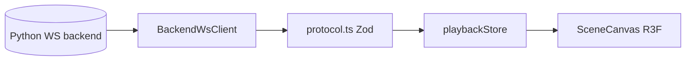

# Architecture

## Layers

```
src/
  app/           AppShell (frame: left pane and the shown section), WorkbenchSection
                 (the workbench views and their state), UI-only Zustand (uiStore)
  components/    Shared UI pieces: Disclosure (+ disclosureStore), PopoverMenu, EmptyState, PageHeader,
                 SectionFrame, LoadingSpinner
  domain/        Simulation protocol, WebSocket client, playback store; cluster/ has the
                 cluster list, the operator API client, the live channel client and stores
  features/      React UI by section: workbench/ (connection, controls, metrics, monitor,
                 scene), cluster/ (with instances/), capabilities/, campaigns/, history/, results/
  language/      Lezer grammar for .problem files
```

## UI conventions

Sizes are tokens in `index.css` (`:root`): body 16px (`--font-size`), captions 13px at the smallest
(`--font-size-xs`), controls and every clickable thing at least 40px (`--control-height`,
`--hit-target`), spacing on a 4px scale (`--space-1` to `--space-6`). Screens use the tokens rather
than their own sizes. One focus ring (`--focus-ring`) covers all keyboard focus. Scrollbars are overlays
(`app/overlayScrollbars.ts`, installed in `main.tsx`): the native ones are hidden and take no room, and
any element with `overflow: auto` gets a thin thumb while it scrolls or the pointer moves over it.

Each screen shows what its main task needs and hides the rest behind progressive disclosure:
`Disclosure` (a button with `aria-expanded`, optionally remembered per browser through its `id`, kept
open with `forceOpen` while it holds an error), `PopoverMenu` for small groups of options laid over a
canvas, and native `details` (given the same chevron and row size globally) in the monitor panels.
A screen has one primary action (`primary-btn accent`), shown in its `PageHeader` or at the top of its
control panel.

A button that only acts and tells nothing by itself (fit the view, hide or show a panel, export, switch
to the map) is an `IconButton` (`components/IconButton.tsx`, icons in `components/icons.tsx`): the icon
alone, its name as the tooltip and the accessible name; `PopoverMenu` takes `iconLabel` for the same.

## Canvas and nautical map

`features/workbench/scene/`: the encounter canvas (`EncounterCanvas.tsx`) and the nautical map
(`NauticalMapView.tsx`) draw the same layers (`EncounterLayers.tsx`, built from `nauticalLayers.tsx`)
under the same toolbar (`CanvasToolbar.tsx`: fit, north up or head up on the canvas, the layer menu, then
the caller's buttons). Every layer is in the one menu (`LayerMenu.tsx`): a row per vessel layer with a
switch per stream (the workbench's preview and simulation side by side, each of which can be hidden),
then the chart's marks (range rings, CPA, labels, legend) and the vector length (`canvasSettings.ts`,
kept per browser and shared by the canvas and the map). The monitor panels hold no layer switches.

The map is Leaflet with the OpenStreetMap tiles and the OpenSeaMap seamarks, darkened by a CSS filter to
the canvas's sea. The layers are an SVG over it, drawn with a canvas view transform that
`geoTransform.mapViewTransform` takes from the map at each move (linearized at its center: the frames'
local meters are UTM easting and northing from the reference geofence, as the backend's `Geofence` has
them). Clicks pass through the drawing to the map; a click near a vessel selects its pair.

## The workbench pages' panels

The panel under the canvas of the Scene Generation, Trajectory Generation and Simulation pages is the
same `StepPanel` (`features/workbench/pages/StepPanel.tsx`): a header with the step, a status chip, where
the run happens and the run button (Stop replaces it while running), a list of what blocks the run
elsewhere (the cluster, the domain configuration, the MQTT broker), then three `StepRow`s: Input (what
the next run takes; `PageInputPanel` offers the previous page's output, Campaign History or a file),
Setup (settings on one line, `Setting` and `NumberSetting`; rarely changed ones behind a link
disclosure), and Result (what the page shows, its entry as a link to Campaign History with
`PageEntryStatus`, Export and the button on to the next page). What the Input row already says is not
repeated as a notice; a disabled run button says in its tooltip what it waits for. The panel takes the
height it needs, at most half the page, until the resizer sets one. Playback is the bar under the
canvas on the trajectory and simulation pages (`WorkbenchEncounterStrip`, on the shown page's store).
Every run is kept as an entry of Campaign History, so the pages record nothing themselves; frames
export from the monitoring panel and the canvas's Export menu.

## Sections

The left pane has seven sections: Workbench (with the views Scene Generation, Trajectory
Generation, Simulation and Connections), Cluster, Domain Configuration (section id `domain`),
Capabilities, Campaigns, Campaign History (section id `history`) and Results. `uiStore` keeps
`section` and `workbenchView` (persisted, v7: the old workbench view `domainConfig` becomes the
section `domain`). Other sections
open an output on a workbench page through `openInWorkbench(target)` in
`features/workbench/pages/workbenchTarget.ts`, which shows the page and queues the target for it
(`takeTarget(page)`). The workbench stays mounted while another section is shown, so its gateway socket and state carry on.

The workbench pages (design doc 6.6, `features/workbench/pages/`): Scene Generation, Trajectory
Generation and Simulation each hold `{input, loaded}` in a persisted page store (`pageStore.ts`): the
input (from the previous page's output, a Campaign History output or a file, `PageInputPanel`) and
the target of the latest loaded entry. Every run is a one-step workbench entry (`entryConfig.ts`
builds its format 3 config; `WorkbenchJobDriver` creates it with `kind: "workbench"` and the page
as origin, follows its case with `entryFollower.ts`, then loads its output). `entryLoader.ts` fetches
a target's output from the master; a 404 clears the page. The shown page takes queued targets with
`useTargetConsumer`, and every page fetches its loaded entry again on start (`useLoadedRefresh`). The left
pane is 280px with a plain-language hint per destination, an icon rail of 72px when collapsed (the
choice is kept per browser) and a bar at the top below 800px. Below 1100px the workbench panes stack
and scroll as one page.

The cluster sections work on the cluster selected in the left pane. `domain/cluster/clusterStore.ts`
keeps the list (name and operator URL, per browser). A master's operator API listens on its
127.0.0.1:5174; from another machine it is reached over `ssh -L 5174:127.0.0.1:5174 <user>@<master>`.

- `operatorApi.ts`: fetch client of the operator routes, answers checked by the Zod schemas
  in `schemas.ts`, errors as `OperatorApiError` with the server's reasons, `X-Total-Count`.
- `liveChannel.ts`: one WebSocket per cluster to `/cluster/live` (contract in `liveProtocol.ts`):
  reference-counted topic subscriptions, snapshot then updates with per-topic `seq`, reconnect
  with backoff and resubscribe, ping. `liveTopics.ts` has the reducers per topic.
- `useLiveTopic(topic, reducer)`: a topic of the selected cluster as React state.
- `presetsApi.ts`: everything the console starts from comes from the master; the frontend ships no
  presets. The FEC catalog's functional scenarios (`GET /cluster/catalog/fecs/<fec id>` as
  text), the domain presets (`GET /cluster/catalog/domain-presets`), the cluster's domain
  configuration (`GET` and `POST /cluster/domain`) and the campaign presets (`GET`, `POST` and
  `DELETE /cluster/campaign-presets`), all read from `backend/assets/` in the master image or the
  master's database.

The domain configuration is global for the cluster. `features/domain/` is its section:
`useClusterDomain()` reads it (also for the workbench, whose runs and monitors take its texts,
and for the wizard's Domain page), `DomainSection` edits a draft per cluster
(`domainDraftStore.ts`, in memory) and saves it with `useSaveClusterDomain()`. The scene page lists
the master's catalog (`useCatalogClasses`, `controls/scenarioCatalog.ts`) and loads a class's text
into its editor; when it loads a generated scene, `pages/inputSpecification.ts` loads the scene's
functional scenario too (the case's `input_artifact`, or the catalog class). The wizard's
`PresetBar` starts a draft from a campaign preset (`presetDraft.ts`: `draftFromConfig`, the inverse
of `configBuilder.ts`) and saves the draft as one without its input (`presetConfigOf`).

## Campaign History and the Cluster page's instances

`features/history/` is Campaign History: every entry of the selected cluster (campaigns and
workbench runs) from `listHistory` (`domain/cluster/historyApi.ts`), kept live by the `campaigns`
topic (`campaignsReducer` in `liveTopics.ts`: pushed rows patch the page, a new, deleted or
filtered-out entry has the page read again; polling while the topic is not live). An entry's page
follows `campaign:<id>` (`useCampaignFeed.ts`) and has a tab per executed step with its outputs
(`listOutputs`); "Open in workbench" and "Watch live" call `openInWorkbench(outputTarget(...))`.
`historyStore.ts` keeps the open entry and step per browser; other sections open an entry with
`showHistoryEntry(id)`. The Campaigns section is the wizard only.

`features/cluster/instances/` is the instance browser of a node (pools and leased jobs, from
`domain/cluster/observableInstances.ts`) with the viewers; a node card's "Instances" opens it.
A viewer subscribes to its `instance:` topic only while it is shown. `domain/cluster/observeFrames.ts`
turns instance samples and frames into encounter view frames (the workbench's job driver uses it too).

## Capabilities

`features/capabilities/` draws the architecture documents of the selected cluster's master
(`GET /cluster/catalog/architecture`, schemas in `domain/cluster/architectureApi.ts`). One document per
part of the system (vessel stack, trajectory generation, scene generation, monitoring), each with a
metamodel (the generic layers, interfaces and adapters) and the concrete implementations over the same
lanes. The page has one tab per document and three views: the implemented graph, the metamodel graph and,
for the vessel stack, the availability matrix. Nothing in the frontend lists implementations: a new
simulator or generator declared in the backend specs appears after the master restarts.

- `capabilitiesModel.ts`: pure helpers (fact tones and formatting, path highlighting, the matrix, the
  `cluster_job` fact of an available stack: the job and runner that run it on a node ("simulation,
  runner kinematic"), or none for a stack the workbench runs only as a live session).
- `graphLayout.ts`: lanes as columns, card order by barycenter sweeps, lane bands.
- `ArchitectureGraph.tsx` (React Flow canvas, custom edge with a label), `GraphNodes.tsx` (cards and
  lane bands), `cardSizes.ts`, `DetailPanel.tsx`, `MatrixView.tsx`, `CapabilitiesSection.tsx`.
- `useFullscreen.ts` and `FullscreenButton.tsx`: full screen for the graph and its detail panel. It
  covers the window at once and asks the browser for the whole screen; where the browser refuses or
  never answers (an embedded browser), the window stays covered. Escape leaves it.
- `nodesStore.ts`: the nodes of the selected cluster from the `nodes` topic, with a REST poll
  while the topic is not live.

## Data flow



## WebSocket lifecycle

1. **Connect**: `BackendWsClient` to the gateway of the active cluster's master (`gatewayWsUrl`; `VITE_WS_URL` without a selected cluster)
2. **Generate scenes and trajectories**: jobs on the active cluster (`features/workbench/cluster/`: `WorkbenchJobDriver` submits `scene_generation`, `trajectory_generation` and `monitoring.post_hoc` jobs through the operator API, follows them on the live channel and reports them to the stores as `generated_scene`, `trajectory_generation_preview` and `trajectory_generation_result`). A job type no usable node offers is not submitted; `workbenchResources.ts` says why.
3. **Load scenario**: `load_scenario_file` -> `preview_trajectory_chunk`(s), then the cluster's post-hoc monitor replaces the preview with monitored frames
   A bare scene loads as its initial scene only (`initial_state` with trajectory length 0); trajectories come from the trajectory generator, and the simulation refuses to run without them.
4. **Run on the cluster**: a kinematic setup runs as one `simulation` job with runner `kinematic`, a replay on ArduPilot SITL or Gazebo as one with runner `ardupilot` and its `simulation_layer` (`simulationJobs.ts`; a plan names the components its job needs, and `workbenchResources.ts` counts the nodes that have them up to date), each as a workbench entry whose run is the matching stack of the campaign config (`pages/entryConfig.ts` `simulationStack`); the frames are observed on `instance:<node>/job-<id>-<attempt>`
5. **Live session**: `connect_to_mqtt_broker` (the master's broker by default), `initialize_simulation` -> `initial_state`, `start_simulation` -> `simulation_trajectory_chunk`(s) and live `frame` pushes

`playbackStore.ts` makes one store per page (`createPlaybackStore`): `useScenePlaybackStore` (the
scene page's scene), `useTrajectoryPlaybackStore` (the planned trajectories) and `usePlaybackStore`
(the simulation page's preview and simulation streams, plus the gateway session: stream, broker,
monitor and simulation status, stack options, errors). `WorkbenchSection` provides the shown page's
store through `PlaybackStoreContext` (`playbackContext.ts`); the canvas, the playback bar and the
monitor panels read it with `useShownPlayback`, so each page renders its own frames. The monitoring
panel shows one stream at a time.

## Tests

`npm test` runs vitest in two projects (`vite.config.ts`). Every `src/**/*.test.{ts,tsx}` runs in the
`node` environment, without a DOM: stores, parsers, clients and static-markup checks
(`renderToStaticMarkup`), with `localStorage` or `window` stubbed where a module needs them
(`src/test/memoryStorage.ts`). A component test that needs a real DOM, with clicks, focus and
state changes, goes in a file named `*.dom.test.tsx` next to the component. Only those files run in
jsdom (chosen over happy-dom for the closest browser behaviour and the widest Testing Library
support; the cost is paid only by the few DOM files), with `src/test/domSetup.ts` as setup: it adds the
`jest-dom` matchers (`toBeVisible`, `toHaveAttribute`, ...) and unmounts after every test and clears
`localStorage`. Write them with React Testing Library: `render` the real component, find elements by role
and name (`screen.getByRole("button", { name: "..." })`), act through `userEvent.setup()` and `await` each
interaction, assert on what the user sees. Reset any Zustand store a test touches in `beforeEach`.
`components/Disclosure.dom.test.tsx` is the pattern to copy.

## Performance

Large trajectory chunks may be merged in a **Web Worker** (`mergeFrames.worker.ts`) before updating the store. Playback uses **requestAnimationFrame** for smooth time advancement.
